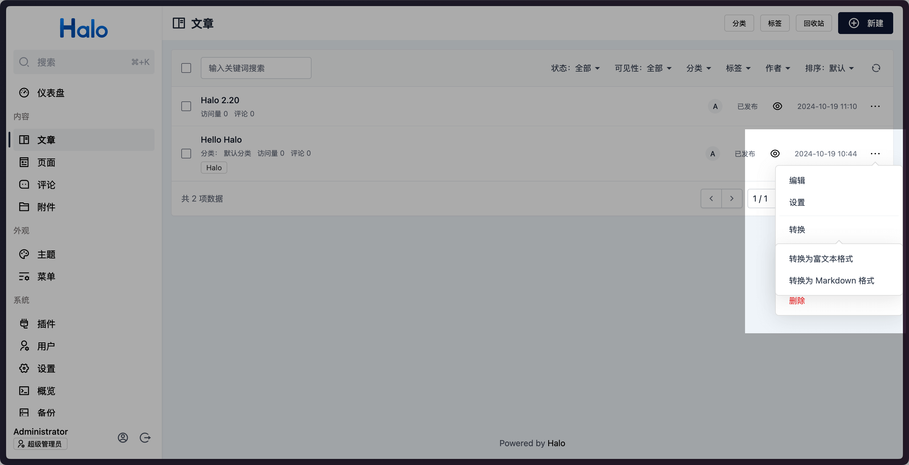
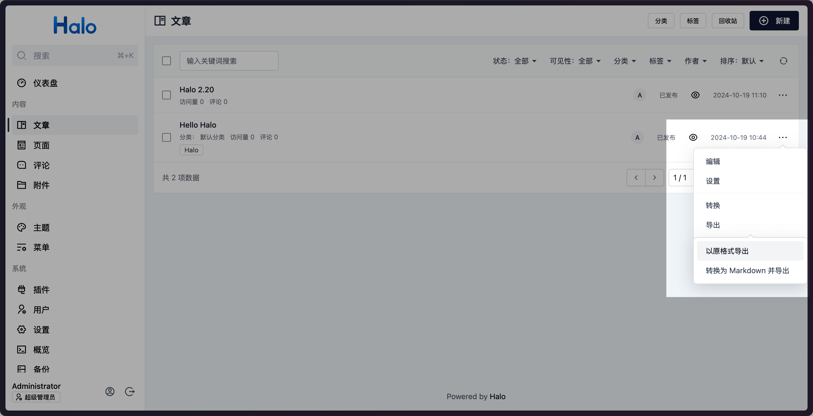
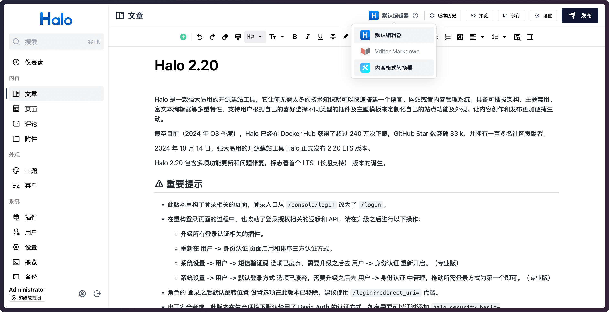
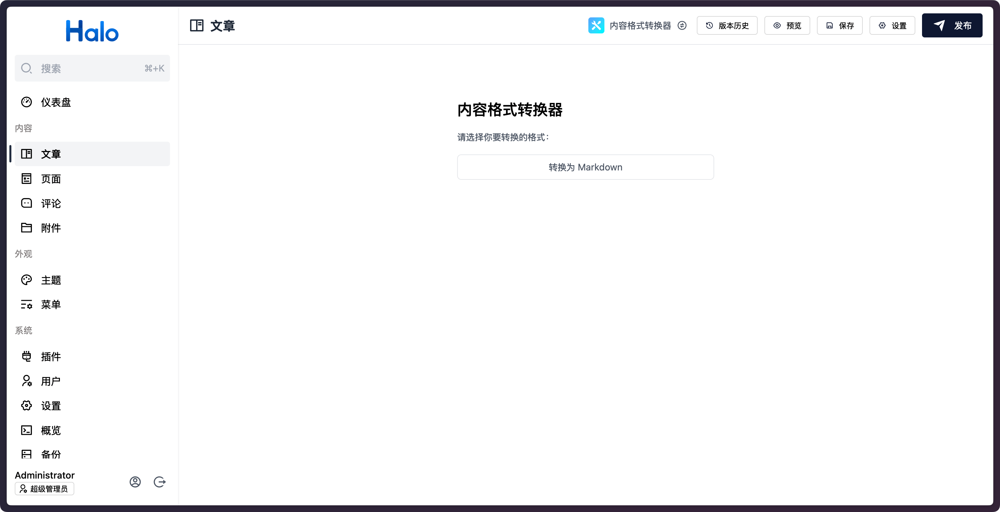
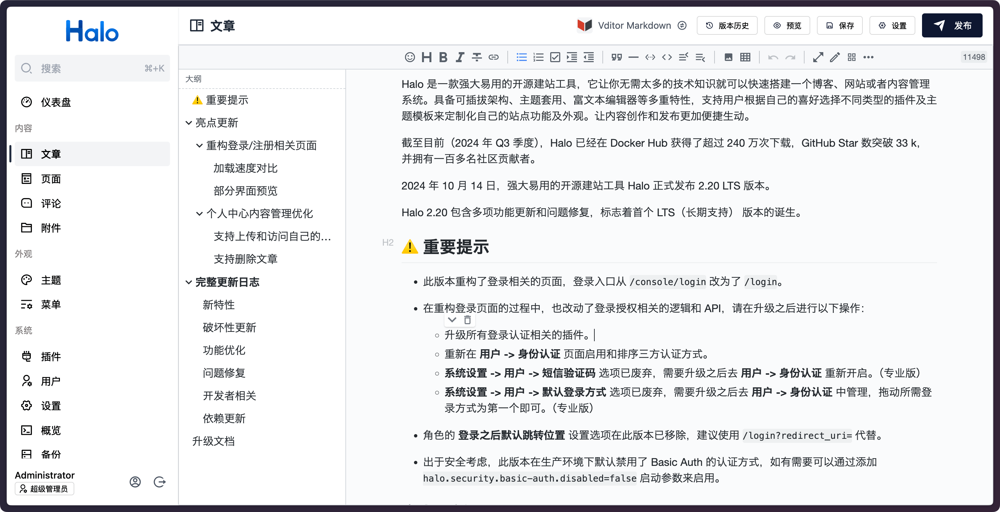
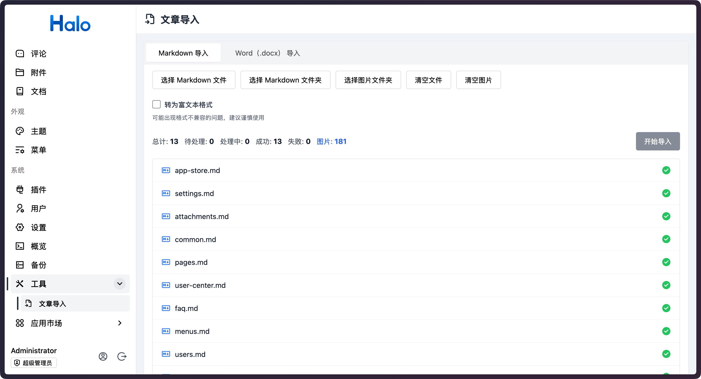
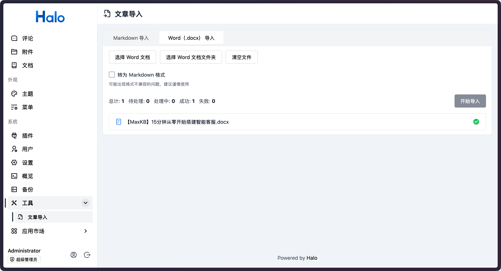

# Halo 内容助手

为 Halo 添加内容格式转换、文章导入导出等功能。

**⚠️ 目前格式转换并不能完全保留原格式，部分语法可能在不同的编辑器中有不同的表现，建议谨慎使用。**

## 特性

- 支持 Markdown 和富文本格式的互转。
- 支持导出文章内容，支持转换为 Markdown 文件导出，支持导出为 PDF。
- 支持 Markdown、Word（.doc、.docx）文档导入，包含关联的图片资源。
- 支持文章克隆。
- 支持复制文章内容。
- 支持内容片段：可将编辑器中选中的内容保存为可复用片段，在编辑器中通过 `/`、`、` 或“插入内容”菜单快速插入，支持中文、全拼和拼音首字母搜索；插入的是片段当前内容的快照，后续修改片段不会影响已插入内容。
- 支持在工具菜单中管理内容片段，支持新建、编辑和删除。

## 使用方式

1. 下载，目前提供以下两个下载方式：
    - Halo 应用市场：<https://www.halo.run/store/apps/app-SUvBR>
    - GitHub Releases：访问 [Releases](https://github.com/ruibaby/plugin-content-tools/releases) 下载 Assets 中的 JAR 文件。
2. 安装，插件安装和更新方式可参考：<https://docs.halo.run/user-guide/plugins>
3. 在文章管理页面中，点击文章的 `···` 按钮即可看到 **转换** 和 **导出** 的功能选项。
4. 也可以在文章编辑页面顶部的编辑器选择框中选择 **内容格式转换器** 进行转换。
5. 在工具菜单中提供了文章导入功能，可以导入本地的 Markdown、Word 文档。
6. 在文章编辑器中选中内容后，可通过浮动菜单的 **保存为片段** 将选区保存为内容片段；输入已有片段名称时可以选择替换原有片段。
7. 在编辑器中输入 `/` 或 `、`，再输入片段名称、全拼或拼音首字母即可插入片段；也可以通过编辑器工具栏的 **插入内容** → **内容片段** 打开选择器，选择器中还支持按描述搜索。
8. 在左侧菜单的 **工具** → **内容片段** 页面中可以新建、编辑、删除和搜索片段。

内容片段相关功能目前仅对超级管理员开放。

## 预览

